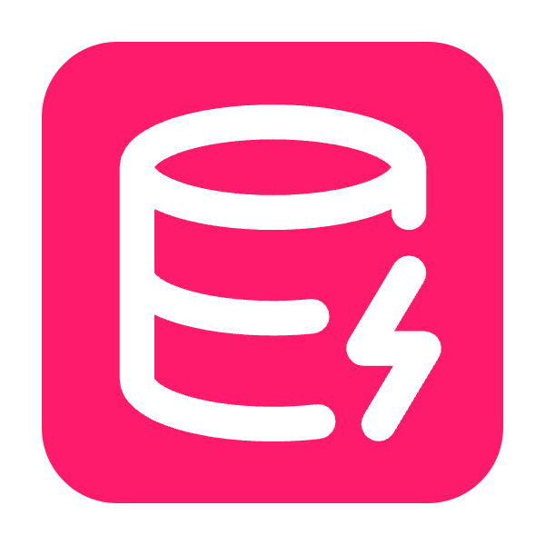
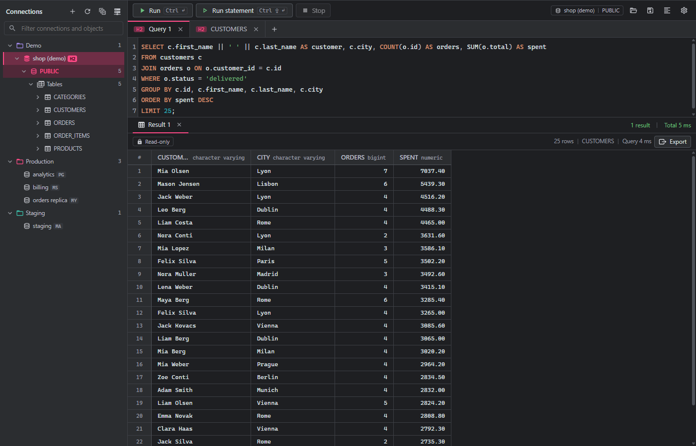
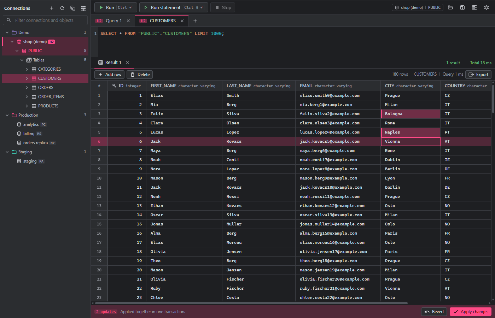
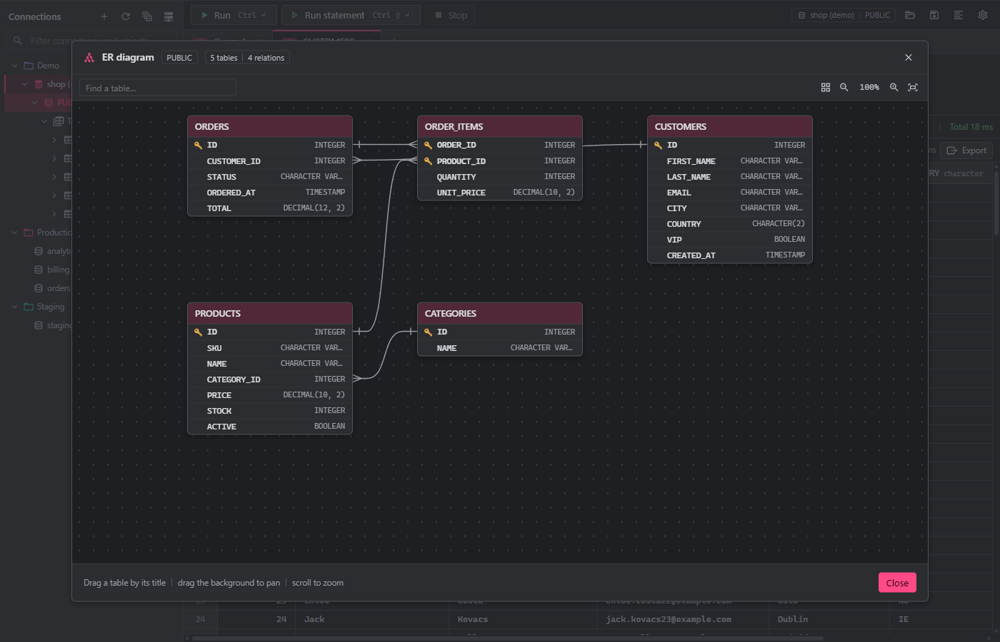
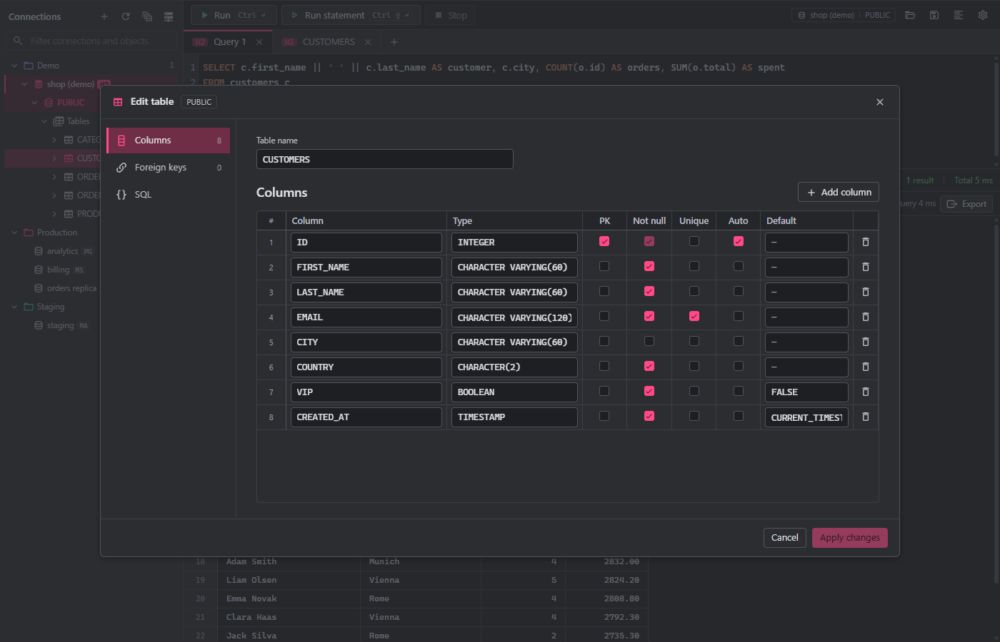
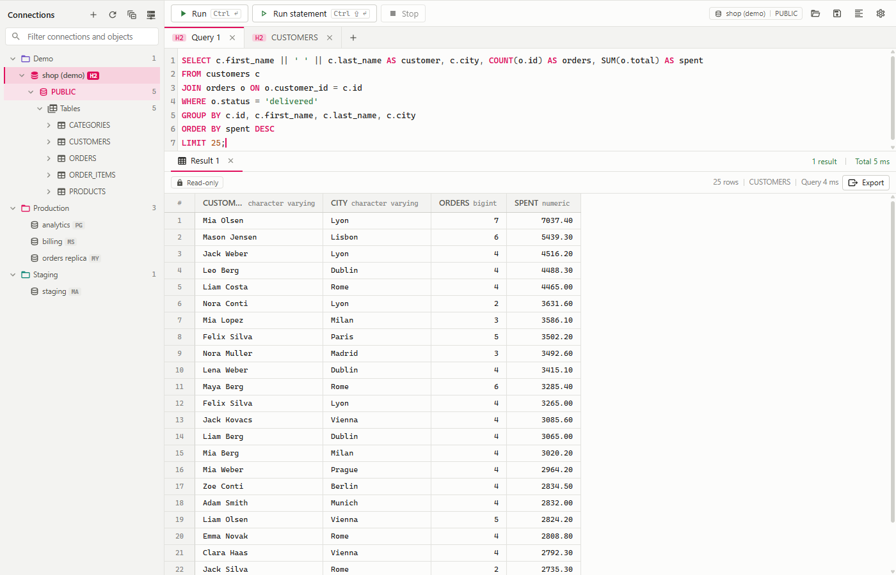
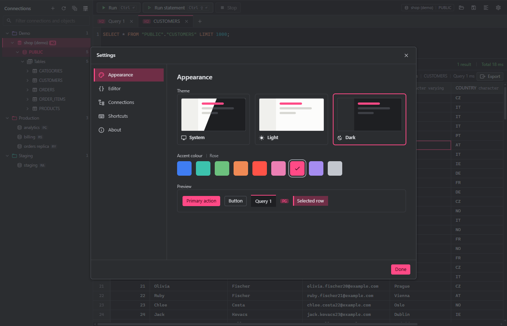

<h1 align="center">
  <br>
  QueryExe
</h1>

<p align="center">
  <b>A fast, free desktop client for working with relational databases.</b><br>
  MySQL | MariaDB | PostgreSQL | SQL Server | H2 | SQLite
</p>

<p align="center">
  
  <a href="https://github.com/B077AS/jolt"></a>
  
  
</p>

<p align="center">
  
</p>

---

## What is QueryExe?

QueryExe is a desktop database client in the spirit of DBeaver and HeidiSQL, built to stay light and quick to start. Connect to several databases at once, browse their schemas, write SQL with highlighting and schema-aware autocomplete, edit result sets right in the grid, and export what you find.

It is a local tool: no server, no account, no telemetry. It only talks to the databases you point it at.

It runs as a single process. Java owns the connections, SQL execution and storage, and the interface is a [Vue 3](https://vuejs.org/) page shown in a native window by [Jolt](https://github.com/B077AS/jolt) (WebView2 on Windows, WebKitGTK on Linux). No Electron, no bundled browser, no local HTTP server.

## Features

**Connections**
- MySQL, MariaDB, PostgreSQL, SQL Server, H2 (file, in-memory or server) and SQLite
- Saved connections grouped in colour-coded folders, with pinning and duplicating
- Passwords live in the operating system's credential store, never in the connection file
- Bundled JDBC drivers, or bring your own driver JAR per connection
- An overview of all open connections with a health check, refresh, reconnect and disconnect

**SQL editor**
- Syntax highlighting and autocomplete that knows your tables and columns, per dialect
- Run everything, the selection, or just the statement under the cursor
- Scripts that return several results show one result tab each; long result sets are capped at 10,000 rows
- Find and replace, comment toggling, SQL formatting
- Open and save `.sql` files, with recent files remembered
- Each query tab has its own database session, so `USE`, `SET` and transactions stay per tab

**Result grid**
- Edit cells, add rows and delete rows directly in the grid, then review and apply everything in one transaction (or revert)
- Edits are written to the right table and key, with quoted and schema-qualified, parameterised statements
- Export results as CSV, JSON or XML
- Fast, virtualised grid with resizable columns, cell selection and copy

<p align="center">
  
</p>

**Schema tools**
- Browse databases, schemas, tables and columns
- Generate `SELECT`, `INSERT` and `CREATE` scripts for any table
- Create, alter and drop tables in a visual table editor, with the generated SQL shown before it runs
- Create and drop databases and schemas
- Table and column properties: keys, indexes and foreign keys
- **ER diagram** of a schema, with the relations between its tables

<p align="center">
  
</p>

<p align="center">
  
</p>

**Server monitor**
- Live charts of sessions and server activity, plus lists of running and blocked sessions, for the server engines

**Look and feel**
- Light, dark or follow-the-system theme
- Nine accent colours, including a rose that matches the app icon
- Keyboard-first: every common action has a shortcut (see Settings, Shortcuts)

<table>
  <tr>
    <td width="50%"></td>
    <td width="50%"></td>
  </tr>
</table>

## Supported databases

| Database | Bundled driver |
|---|---|
| MySQL | Connector/J 9.5.0 |
| MariaDB | 3.5.6 |
| PostgreSQL | 42.7.8 |
| SQL Server | 13.2.1.jre11 |
| H2 | 2.4.240 |
| SQLite | 3.51.1.0 |

Any of them can be swapped for another version or a custom build from the connection dialog.

> H2 and SQLite are the engines exercised most by the automated tests. The server engines are supported through the same code paths, but have seen less real-world use, so expect rough edges and please report them.

## Download

Get the latest build from the [Releases page](https://github.com/B077AS/query-exe/releases/latest):

| File | For |
|---|---|
| `QueryExe-Setup.exe` | Windows installer (per user, no admin rights) |
| `QueryExe.AppImage` | Linux, as a single file: `chmod +x QueryExe.AppImage`, then run it |

Both carry their own Java runtime and **update themselves**: QueryExe opens a small window first, checks GitHub, downloads only what changed and then starts. On Linux the web view (WebKitGTK) and the keyring (libsecret) come from the system. The Windows installer is not code-signed, so SmartScreen may warn on first run. The other files on a release (`jpack-*.json`, `runtime-*.zip`, `stub-*.zip`, the jars) are what the installed copies update from; you do not need them.

## Building from source

Requirements: **JDK 25** (Jolt uses the Foreign Function & Memory API), Maven and Node.js.

```bash
git clone https://github.com/B077AS/query-exe
cd query-exe

# 1. build the page (type-checks, then writes it to src/main/resources/ui)
cd frontend
npm install
npm run build
cd ..

# 2. run the app
mvn compile exec:exec
```

The exec plugin launches `${java.home}/bin/java`, so make sure `JAVA_HOME` points at JDK 25 before running Maven.

**Hot reload while working on the UI:** run `npm run dev` in `frontend/` in one terminal, then `mvn compile exec:exec -Dqueryexe.dev=true` in another.

**Try it without touching your real connections:** `mvn compile exec:exec -Dqueryexe.data=<folder>` keeps connections, settings and web-view data in that folder instead.

**Build a runnable JAR** (build the page first, as above):

```bash
mvn clean package
java -jar target/query-exe-<version>.jar
```

### Where your data lives

| OS | Folder |
|---|---|
| Windows | `%APPDATA%\QueryExe` |
| Linux | `~/.config/QueryExe` |

It holds your saved connections (`data/connections.json`), settings (`config/settings.json`), custom JDBC drivers (`jdbc-drivers/`) and logs (`logs/`).

## Tests

```bash
mvn test
```

The tests are plain JUnit 5 and need no window: they pin the SQL each dialect generates, exercise grid edits and the script runner against real H2 and SQLite databases, and cover the SQL splitter and the schema readers.

## Under the hood

| Part | Responsibility |
|---|---|
| `frontend/` | The Vue 3 + TypeScript page: CodeMirror 6 editor, hand-written virtual grid, Reka UI dialogs and menus, plain CSS with design tokens |
| `app/`, `api/` | The bridge between the page and Java: typed request/response calls plus pushed events, one handler class per area |
| `engine/` | Everything one database engine needs: its SQL dialect and its schema reader, one package per engine |
| `connection/` | Saved connections, the credential vault, open connections and custom driver loading |
| `schema/` | Reads a connection's structure into the tree the page shows |
| `query/` | Query tabs, script execution, the editable result grid, export |
| `monitor/` | The server monitor |
| `store/` | Settings and recent files |

## Tech stack

| Layer | Technology |
|---|---|
| Language / runtime | Java 25 |
| Window and bridge | [Jolt](https://github.com/B077AS/jolt): a native window hosting a web page, no HTTP server |
| UI | Vue 3, TypeScript, Vite, CodeMirror 6, Reka UI, Material Design Icons |
| Database connectivity | JDBC drivers for MySQL, MariaDB, PostgreSQL, SQL Server, H2, SQLite |
| Credentials | OS credential store via `credential-secure-storage` |
| Serialization | Gson |
| Build | Maven (shade plugin for the fat JAR), Vite for the page |
| Misc | Logback, Lombok, sql-formatter |

## Contributing

Contributions are welcome! Please feel free to submit a Pull Request.

1. Fork the repository
2. Create your feature branch (`git checkout -b feature/AmazingFeature`)
3. Commit your changes (`git commit -m 'Add some AmazingFeature'`)
4. Push to the branch (`git push origin feature/AmazingFeature`)
5. Open a Pull Request

## FAQ

**Is QueryExe free?** Yes. It is MIT-licensed, with no ads, no tracking and no paid tiers.

**Do I need a server or an account?** No. QueryExe is a local desktop tool and only connects to the databases you configure.

**Why not Electron?** Jolt shows the page in the system's own web view, so there is no bundled browser: a smaller download and less memory.

**Does it work on Linux?** It is built for it (WebKitGTK), but so far it has mostly been run and tested on Windows.

## Acknowledgments

- [Jolt](https://github.com/B077AS/jolt) for the native window and bridge
- [Vue](https://vuejs.org/), [CodeMirror](https://codemirror.net/) and [Reka UI](https://reka-ui.com/)
- [Material Design Icons](https://pictogrammers.com/library/mdi/)

## License

This project is licensed under the [MIT License](LICENSE).

---

<p align="center">
<b>Made with Java</b><br>
If you find QueryExe useful, consider giving it a ⭐!
</p>
